# AWS Secure VPC — Multi-AZ Production Architecture

Terraform project that provisions a multi-AZ AWS setup: public ALB, private Auto Scaling app instances, bastion jump host, NAT Gateway, and locked-down security groups.

**Region:** `us-east-1` · **Project prefix:** `secure-vpc-dev`

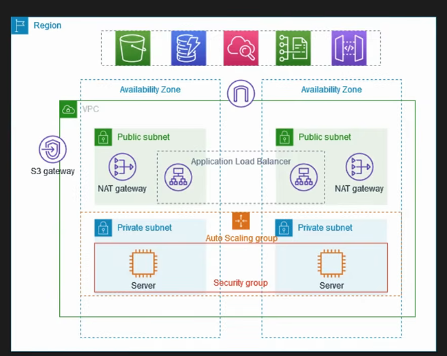

---

## Architecture

```text
                         Internet
                            |
                     [ HTTP :80 ]
                            |
                    ┌───────▼───────┐
                    │  ALB (public) │  ← public subnets (2 AZs)
                    │  Listener :80 │
                    └───────┬───────┘
                            | forwards to :8000
              ┌─────────────┴─────────────┐
              ▼                           ▼
     ┌────────────────┐          ┌────────────────┐
     │ App EC2 (ASG)  │          │ App EC2 (ASG)  │
     │ Private AZ-a   │          │ Private AZ-b   │
     │ Python :8000   │          │ Python :8000   │
     └───────▲────────┘          └───────▲────────┘
             | SSH only                    | SSH only
             └──────────┬─────────────────┘
                        |
                 ┌──────┴──────┐
                 │   Bastion   │  ← public subnet + public IP
                 └──────▲──────┘
                        | SSH :22
                     Admin / You

Private outbound (apt, etc.): App → NAT Gateway → IGW → Internet
Public inbound to apps:       NOT allowed (no public IP; SG locked)
```

| Layer | What it does |
|-------|----------------|
| **VPC `10.0.0.0/16`** | Isolated network with DNS hostnames enabled |
| **2 public + 2 private subnets** | Same 2 AZs for high availability |
| **IGW** | Internet access for public subnets / ALB |
| **NAT Gateway + EIP** | Private instances get outbound internet only |
| **Public RT** | `0.0.0.0/0 → IGW` |
| **Private RT** | `0.0.0.0/0 → NAT` |
| **ALB SG** | Inbound HTTP 80 from anywhere |
| **Bastion SG** | Inbound SSH 22 from admin CIDR |
| **App SG** | Port 8000 only from ALB SG; SSH 22 only from Bastion SG |
| **ASG (min 1 / desired 2 / max 3)** | Runs app instances in private subnets |
| **ALB + Target Group** | Public HTTP → healthy instances on port 8000 |
| **Bastion** | Jump host to SSH into private apps |

---

## Project layout

```text
aws-secure-vpc/
├── versions.tf              # Terraform + AWS provider
├── variables.tf             # Inputs (CIDR, key name, ASG sizes)
├── network.tf               # VPC, subnets, IGW, NAT, routes
├── security.tf              # ALB / Bastion / App security groups
├── compute.tf               # Launch template, ASG, bastion, user_data
├── alb.tf                   # ALB, listener, target group
├── outputs.tf               # ALB URL, bastion IP, helpers
├── terraform.tfvars.example # Copy to terraform.tfvars
└── README.md
```

---

## Deploy

### Prerequisites
- AWS CLI configured (`aws configure`)
- Terraform `>= 1.5`
- EC2 key pair in `us-east-1` (private `.pem` kept **out of git**)

### Steps

```bash
cd aws-secure-vpc
cp terraform.tfvars.example terraform.tfvars
# Set key_name to your key pair name in terraform.tfvars

terraform init
terraform plan
terraform apply
```

```bash
terraform output alb_url
curl "$(terraform output -raw alb_url)"   # must use http:// not https://
```

### Destroy (stops NAT/ALB charges)

```bash
terraform destroy
```

---

## Console walkthrough (screenshots)

> Screenshots live under `pics/` next to this README (gitignored). Open them locally while reading this section.

### 1. VPC
Custom VPC `secure-vpc-dev-vpc` with CIDR `10.0.0.0/16`, DNS enabled, multi-AZ resource map.

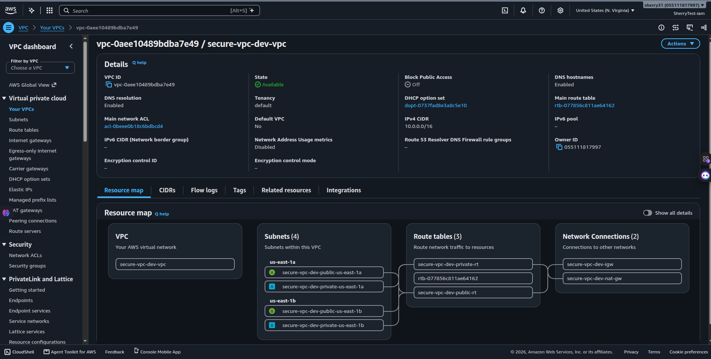

### 2. Subnets
Four subnets: public + private in `us-east-1a` and `us-east-1b`.

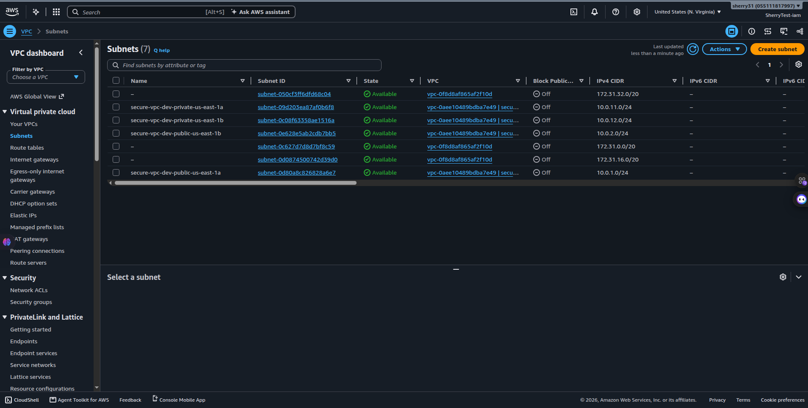

### 3. Internet Gateway
`secure-vpc-dev-igw` attached to the VPC for public internet.

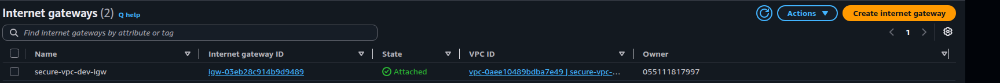

### 4. NAT Gateway
`secure-vpc-dev-nat-gw` in a public subnet with an Elastic IP — private apps use this for outbound traffic.

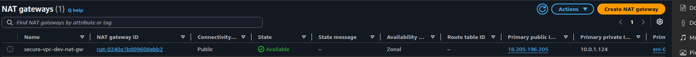

### 5. Route tables
Public RT → IGW · Private RT → NAT · subnet associations for both tiers.

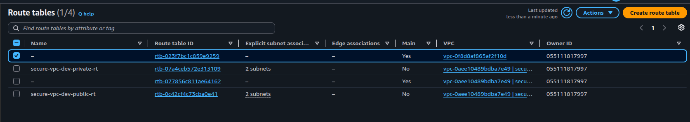


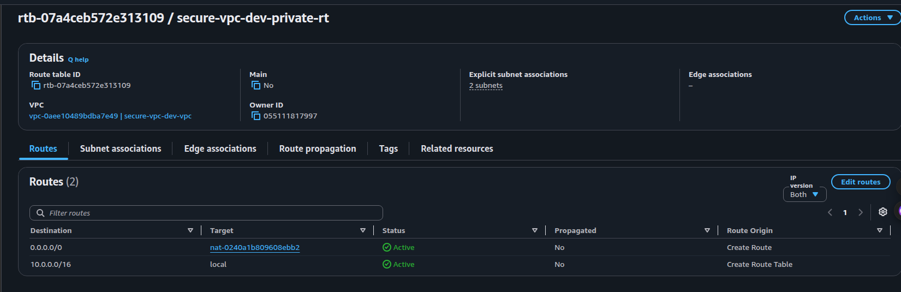

### 6. Security groups
Three SGs with tight rules: ALB (80), Bastion (22), App (8000 from ALB + 22 from Bastion only).

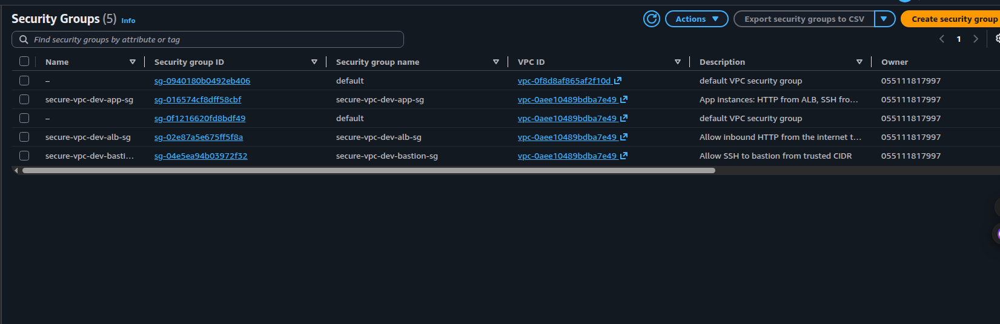

### 7. Launch template
Ubuntu 22.04 launch template used by the ASG (`user_data` starts Python HTTP on port 8000).

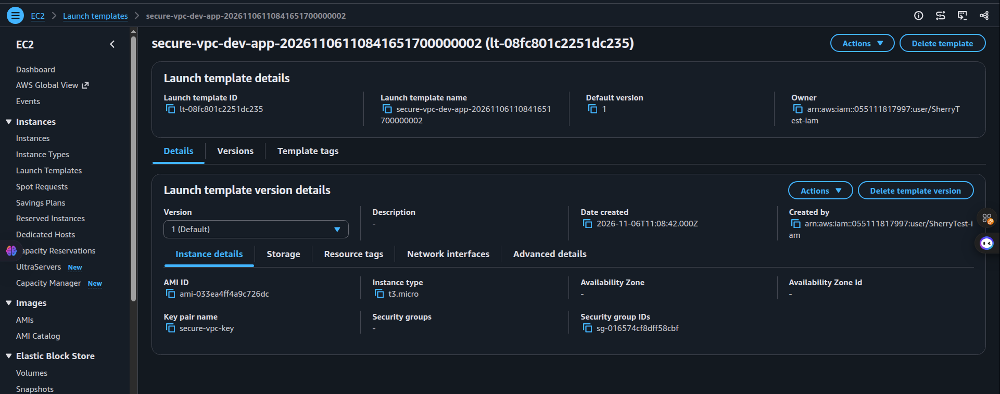

### 8. Target group
ALB target group on port **8000**, health check `/`, both ASG instances **healthy**.

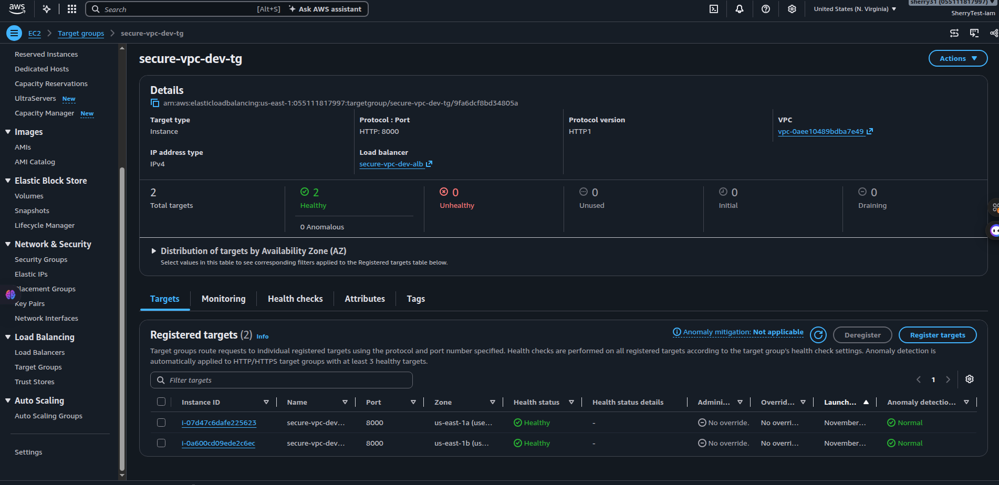

---

## Load balancer test (two websites)

To prove the ALB spreads traffic, each private instance was given a different static page:

| Instance | Page |
|----------|------|
| `10.0.11.243` | **WEBSITE A (BLUE)** |
| `10.0.12.159` | **WEBSITE B (GREEN)** |

Open the ALB with **HTTP** (not HTTPS):

```text
http://<alb-dns-name>
```

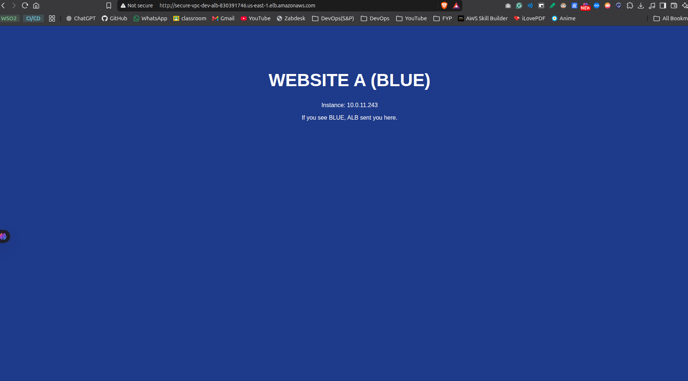

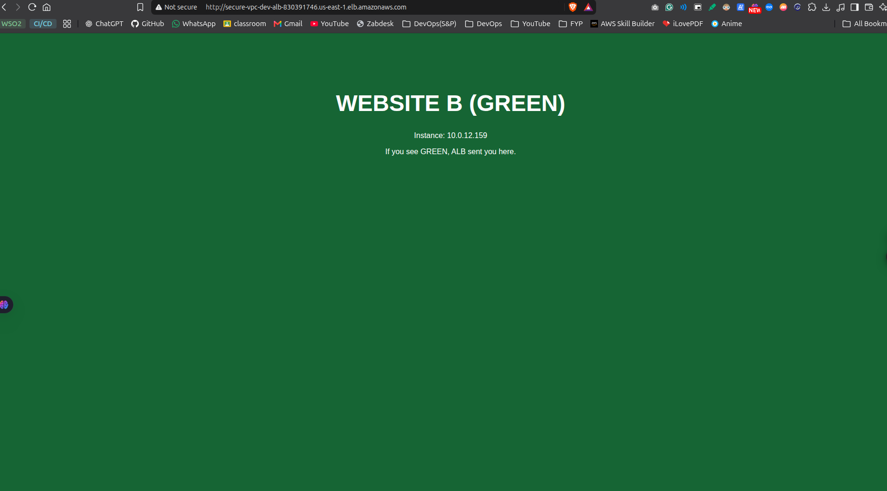

Browsers may stick to one instance (HTTP keep-alive). Use curl for a clear mix:

```bash
for i in $(seq 1 20); do
  curl -s http://<alb-dns-name> | grep WEBSITE
  sleep 1
done
```

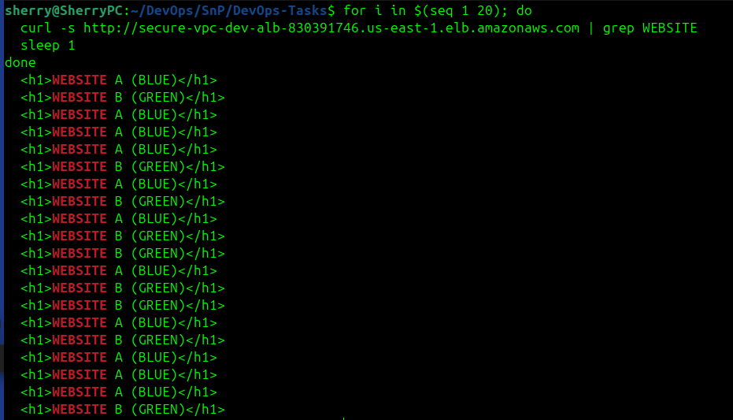

Seeing both BLUE and GREEN from the same URL confirms load balancing.

---

## SSH via bastion

App instances have **no public IP**. Path: laptop → bastion → private EC2.

```bash
# Bastion
ssh -i /path/to/aws-secure-vpc.pem ubuntu@<bastion-public-ip>

# Or one-shot jump to a private instance
ssh -i /path/to/aws-secure-vpc.pem \
  -o ProxyJump=ubuntu@<bastion-public-ip> \
  ubuntu@<private-ip>
```

---

## Security notes

- `*.pem` and `aws-secure-vpc.pem` are gitignored — never commit private keys
- `pics/` is gitignored (local evidence only)
- `terraform.tfvars` is gitignored; use `terraform.tfvars.example` as the template
- Prefer `bastion_ssh_cidr = "YOUR.IP/32"` instead of `0.0.0.0/0` outside labs
- This lab ALB is **HTTP only** (port 80). HTTPS needs an ACM certificate + :443 listener
